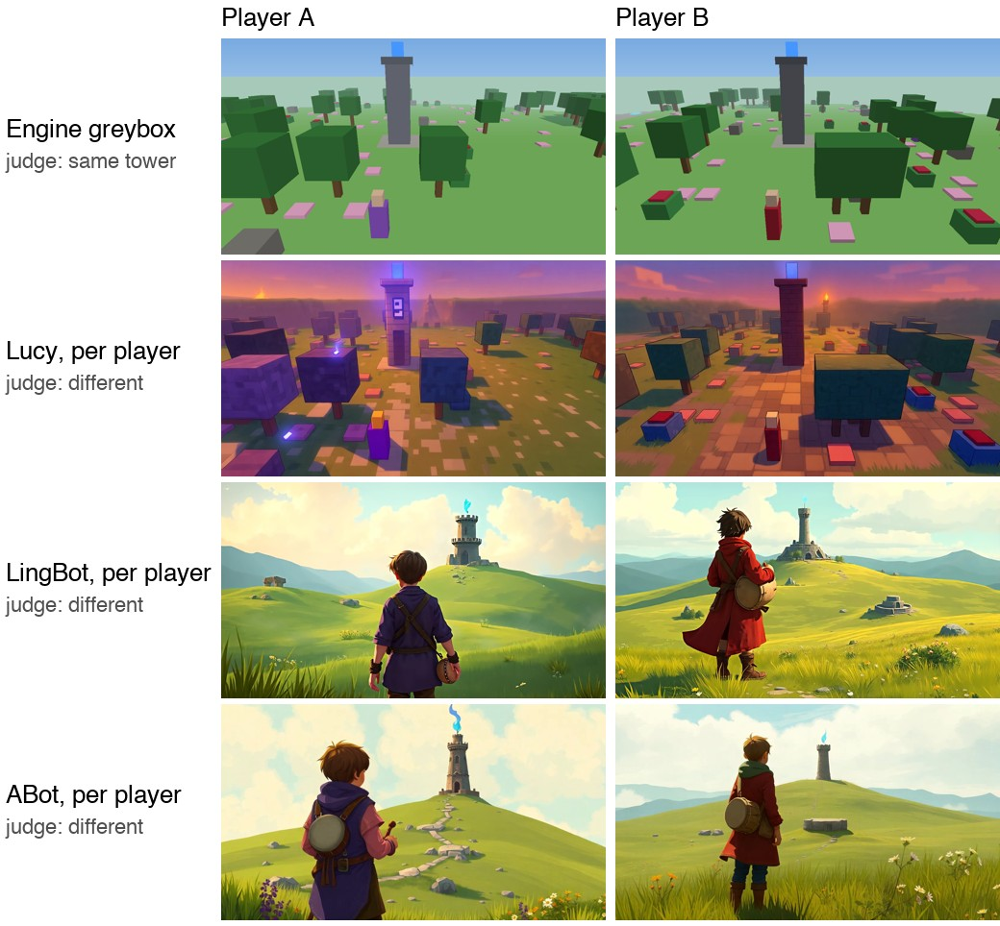

# Everfold

A real-time multiplayer open world that writes itself as players walk, built as a testbed for comparing
generative world models. The game server holds every fact. World models only draw what a player's camera sees,
and the benchmark grades their frames against the server's truth.

**Paper:** *Everfold: Do Generative World Models Give Two Players the Same World?*, Wanzhen Jiang, 2026
([PDF](paper/everfold.pdf); arXiv link to come). **Frames, judge verdicts and human labels:** on Hugging Face (link to come).



Two players look at the same watchtower. Only the engine's own render gives them the same tower; every
per-player model draws its own.

| Condition (20 seeds) | Both see the tower | Same tower | State change seen by the other player |
|---|---|---|---|
| ABot / LingBot, one session per player | 75–80% | 5–10% | 0–2% (driven, one session) |
| Lucy restyling the engine render, per player | 80% | 35% | 0% |
| Engine greybox | 100% | 100% | see the paper (occlusion) |

The research log is in [docs/paper-plan.md](docs/paper-plan.md).

## Play

```bash
uv venv .venv && uv pip install -e ".[dev,claude]"
```

```bash
.venv/bin/python -m everfold.cli serve
```

Open http://localhost:8765 in two browser windows to play together.

| Key | Does |
|---|---|
| WASD or arrows | walk |
| E | gather from a tree, bush, rock, flowers or chest |
| F | light a campfire (costs one wood) |
| T | talk to the nearest villager |
| G | hand items to a villager for a quest |
| Enter | chat with players near you |

Without `ANTHROPIC_API_KEY` villagers and quests are scripted. With it, Claude writes each villager the first time
someone comes near, voices them in conversation, and writes quests on the spot. Every quest is checked against
the real map before a player sees it.

## What is generated, and when

| Thing | When | How |
|---|---|---|
| Terrain, rivers, forests, peaks | the moment a chunk comes into range | seeded noise, identical every time |
| Villages, shrines, ruins, stables, towers | with their chunk | seeded placement |
| Villager names and personalities | first time a player comes within 12 tiles | Claude, or scripted |
| Dialogue | each conversation | Claude, with memory of each player and gossip about what other players did |
| Quests | when a villager decides to ask | Claude, validated against real places, people and items |

Shrines open only when two different players stand on both plates at once. Felled trees stay felled. Bushes,
chests and flowers regrow. Everything players change is saved to SQLite and survives a restart.

## Benchmark

```bash
.venv/bin/python -m everfold.cli bench --adapter reference
```

| Adapter | Use |
|---|---|
| `reference` | top-down render of the true state; a pipeline check, not a world model |
| `prompts` | writes `prompts.md` so you can run any model by hand |
| `folder --frames DIR` | judges frames you captured by hand, named `<step id>.png` |
| `odyssey` | Odyssey-2 Pro through its Python SDK; needs `ODYSSEY_API_KEY` and `uv pip install -e ".[odyssey]"` |
| `abot`, `lingbot`, `eden` | ABot-World-0, LingBot-World-2, Eden Live 14B Game on fal, headless over WebRTC; need `FAL_KEY` and `uv pip install -e ".[fal]"` |
| `greybox` | the engine's own 3D render of the true state; free |
| `flux-oracle` | FLUX.1 schnell on fal draws each frame from the true-state prompt; the stateless ceiling; needs `FAL_KEY` |
| `lucy [--per-player]` | Decart Lucy Restyle on fal restyles a greybox clip per probe family (or per player); needs `FAL_KEY` |

The five probes are cross-view agreement, revisit retention, cross-player state propagation, identity
persistence, and shared-structure state change. A Claude vision judge marks each ground-truth fact present,
absent or unclear. It never sees the prompt. Results land in `runs/<adapter>-seed<n>/report.md`.

ABot draws mostly from its start image, so it has two start conditions. `--start preset` (the default) keeps
fal's built-in world and steers it by prompt only. `--start image` first makes a start image from each probe
family's opening prompt with FLUX schnell on fal, about $0.003 per image. A full run of 14 steps opens 5 sessions
and uses about 2 to 3 minutes of ABot time, roughly $0.20. Session time, cost, and response times go into
`metrics.json` under `renderer`.

## World models in the live panel

Keys live in a `.env` file in this folder (git ignores it). The server reads it at start and never sends a key to
the browser: Odyssey gets short-lived session tokens, and fal traffic goes through a narrow proxy that only opens
ABot-World-0 realtime sessions.

| Option in the panel | Key in `.env` | Cost |
|---|---|---|
| ABot-World-0 via fal (live) | `FAL_KEY` | $0.00125 per second, about $4.50 per hour |
| Odyssey-2 Pro (live) | `ODYSSEY_API_KEY` | access by request |

With ABot, your WASD and arrow keys drive its camera and the server's view prompt steers its scene. It keeps its
own world, so watch how far it drifts from the map on the left.

To watch Odyssey live in the game, set `ODYSSEY_API_KEY` before `serve`, install the Odyssey extra, and pick
"Odyssey-2 Pro (live)" in the World model view panel. The key stays on the server.

## Layout

| Path | Job |
|---|---|
| `everfold/world.py` | chunked map generation and player changes |
| `everfold/game.py` | the authoritative game: movement, gathering, shrines, villagers, quests, events |
| `everfold/content/` | Claude calls with scripted fallbacks: villagers, dialogue, quests |
| `everfold/render/` | camera view, prompt compiler, reference renderer |
| `everfold/bench/` | probes, adapters, judge, scoring |
| `everfold/server.py` | WebSocket server and static client |
| `client/` | browser client and live renderer plug-ins |

## Reproduce the paper

Each condition runs on the same seeds (42, then 1, 2, 3, ...) under a spending cap, and the aggregate reports each
probe as a mean over seeds with a 95% bootstrap interval:

```bash
.venv/bin/python -m everfold.cli sweep greybox:20 lucy-greybox-2p:20 abot-image-2p:20 --budget 10 --tag repro
```

```bash
.venv/bin/python -m everfold.cli aggregate
```

Human agreement: `everfold label` opens a labelling page on a frame sample, and `everfold agreement` reports
Cohen's kappa against the judge or another labeller.

## Tests

```bash
.venv/bin/python -m pytest -q
```

## Licence and citation

Code: MIT (see `LICENSE`). Frames and labels on Hugging Face: CC BY 4.0.

```bibtex
@misc{jiang2026everfold,
  title  = {Everfold: Do Generative World Models Give Two Players the Same World?},
  author = {Jiang, Wanzhen},
  year   = {2026},
  note   = {arXiv preprint, to appear}
}
```
